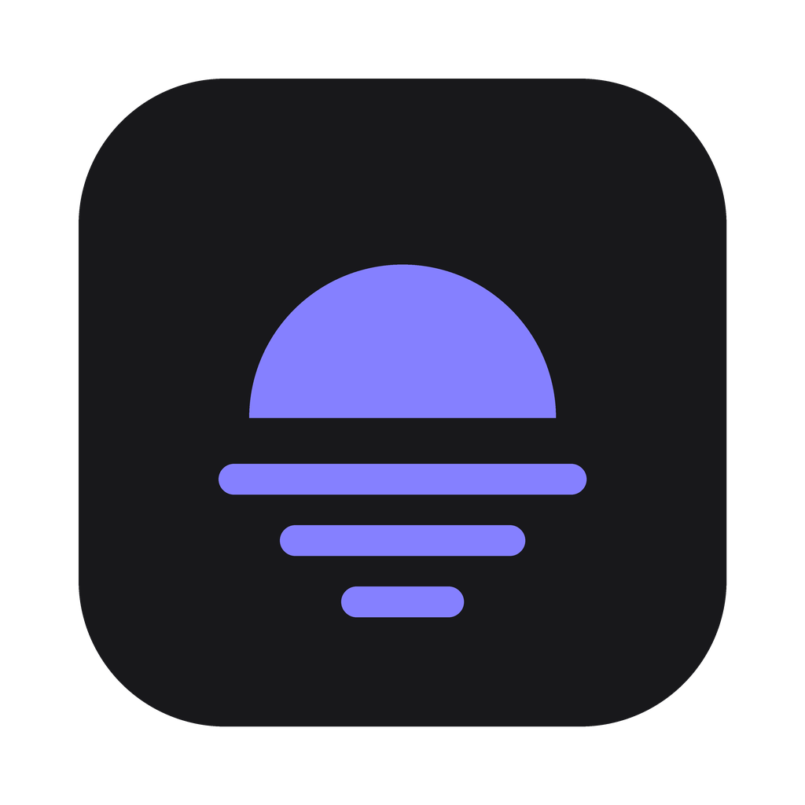
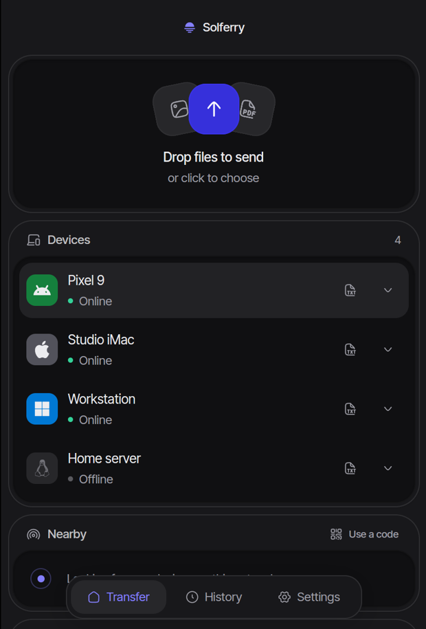
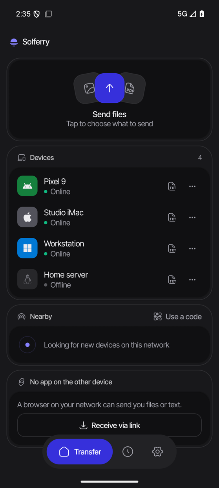

<div align="center">



# Solferry

**Send files between your devices. No account, nothing in the cloud.**

[](https://github.com/berkinory/solferry/releases)
[](https://github.com/berkinory/solferry/actions/workflows/ci.yml)
[](LICENSE)


[Download](#download) · [Documentation](docs/README.md) · [Run a relay](docs/relay.md) · [Security](SECURITY.md)

</div>

<p align="center">
  
  &nbsp;&nbsp;
  
</p>

Solferry is an open source, accountless alternative to AirDrop and LocalSend. Files go straight from one device to another, end-to-end encrypted, over your local network or Tailscale. There is no sign-up, no upload step and no server of ours anywhere in the path. If you want to reach devices on other networks, you run your own relay and everyone you pair with uses it.

> [!NOTE]
> Solferry is in early development. The desktop apps, the Android app and the command line tool are released. The iOS app is built and tested on the simulator, and ships later.

## Highlights

- **Private by design.** No accounts, no telemetry and no servers to trust. A device is its key, and every connection is end-to-end encrypted with TLS 1.3.
- **Fast and resilient.** Large files move as parallel segments and resume after a dropped connection or a restart. Every file is checked against the sender's BLAKE3 hash before it lands.
- **You decide who can send.** Unpaired devices have to ask, and you can block them. Pairing never accepts files on its own.
- **Works where you are.** Local network and Tailscale out of the box. Your own relay for everything else, set up with one command.
- **Waits for offline devices.** Send to a paired device that is away and it gets the files when it comes back, still asking first.
- **Fits into each platform.** Share sheet on macOS and Android, drop on the Dock icon, menu bar popover, Android Quick Settings tile, Accept and Decline from the notification.
- **Thoughtful details.** HEIC photos turn into JPEG for devices that can't open them. Texts and links go to the other device's clipboard. A browser can send or take files without the app.
- **Scriptable.** A full command line tool for servers, pipes and headless machines, with JSON output.

## Download

| Platform | Download | Requires |
|---|---|---|
| macOS, Apple silicon | [Solferry-macos-aarch64.dmg](https://github.com/berkinory/solferry/releases/latest/download/Solferry-macos-aarch64.dmg) | macOS 12 |
| macOS, Intel | [Solferry-macos-x86_64.dmg](https://github.com/berkinory/solferry/releases/latest/download/Solferry-macos-x86_64.dmg) | macOS 12 |
| Windows | [Solferry-windows-setup.exe](https://github.com/berkinory/solferry/releases/latest/download/Solferry-windows-setup.exe) | Windows 10, x64 |
| Linux, x86_64 | [Solferry-linux-x86_64.AppImage](https://github.com/berkinory/solferry/releases/latest/download/Solferry-linux-x86_64.AppImage) | glibc 2.35 |
| Linux, ARM64 | [Solferry-linux-aarch64.AppImage](https://github.com/berkinory/solferry/releases/latest/download/Solferry-linux-aarch64.AppImage) | glibc 2.35 |
| Android | [Solferry-android.apk](https://github.com/berkinory/solferry/releases/latest/download/Solferry-android.apk) | Android 10 |
| Command line, Linux | [x86_64](https://github.com/berkinory/solferry/releases/latest/download/solferry-cli-linux-x86_64.tar.xz) · [ARM64](https://github.com/berkinory/solferry/releases/latest/download/solferry-cli-linux-aarch64.tar.xz) | any |

The macOS apps and the Windows installer include the `solferry` command. With Homebrew:

```sh
brew tap berkinory/brew
brew install --cask solferry   # macOS app, with the solferry command
brew install solferry-cli      # command line tool alone, on Linux
```

The desktop apps update themselves, which you can turn off in Settings. See [Installation](docs/install.md) for first launch notes on each platform.

## Quick start

1. Install Solferry on two devices on the same network, or on the same Tailscale network.
2. Each one shows the other under **Nearby**. Press **Pair** and check that both screens show the same six digits.
3. Drop files on the window, share them to Solferry, or press the send button, then pick a device.

You don't have to pair to send. An unpaired device on your network gets asked, and can accept, decline or block you.

From a terminal:

```sh
solferry receive                          # on one device
solferry send photos/ --to my-laptop      # on the other
```

The [user guide](docs/guide.md) covers everything else, and the [CLI reference](docs/cli.md) covers every command.

## Who can send you files

| | Paired | Not paired |
|---|---|---|
| Same network or Tailscale | asks you, or arrives right away if you chose that for the device | asks you, and you can block them |
| Through a relay | asks you, or arrives right away if you chose that for the device | refused, you never see it |

A paired device asks until you pick **Always accept** on one of its offers. That choice is stored on your device only and never comes from the other side. [How trust works](docs/trust.md) explains the rest.

## How it compares

| | Solferry | LocalSend | AirDrop |
|---|---|---|---|
| Open source | yes | yes | no |
| No account | yes | yes | Apple ID |
| Windows, Linux and Android | yes | yes | no |
| Tailscale and other overlays | finds devices by itself | by IP address | no |
| Across the internet | through your own relay | no | no |
| Resumes interrupted transfers | yes | no | no |
| Waits for offline devices | yes | no | no |

## Documentation

| | |
|---|---|
| [Installation](docs/install.md) | Downloads, first launch and updates on every platform |
| [User guide](docs/guide.md) | Pairing, sending, receiving, texts, the queue and settings |
| [Command line](docs/cli.md) | Every `solferry` command, with examples |
| [Trust and privacy](docs/trust.md) | Who can reach you, what is encrypted and what a relay sees |
| [Run a relay](docs/relay.md) | Reach devices on other networks with your own server |
| [Troubleshooting](docs/troubleshooting.md) | Devices that don't show up, firewalls and permissions |
| [Building from source](docs/building.md) | Desktop, Android, iOS and the CLI |
| [Architecture](docs/architecture.md) | How the code is laid out and why |
| [Protocol](docs/protocol.md) | What goes over the wire |

## Contributing

Bug reports, ideas and pull requests are welcome. Start with [CONTRIBUTING.md](CONTRIBUTING.md) for setup and conventions, and [Building from source](docs/building.md) to run the apps. Please report security issues privately as described in [SECURITY.md](SECURITY.md).

## License

Solferry is released under the [MIT License](LICENSE).
